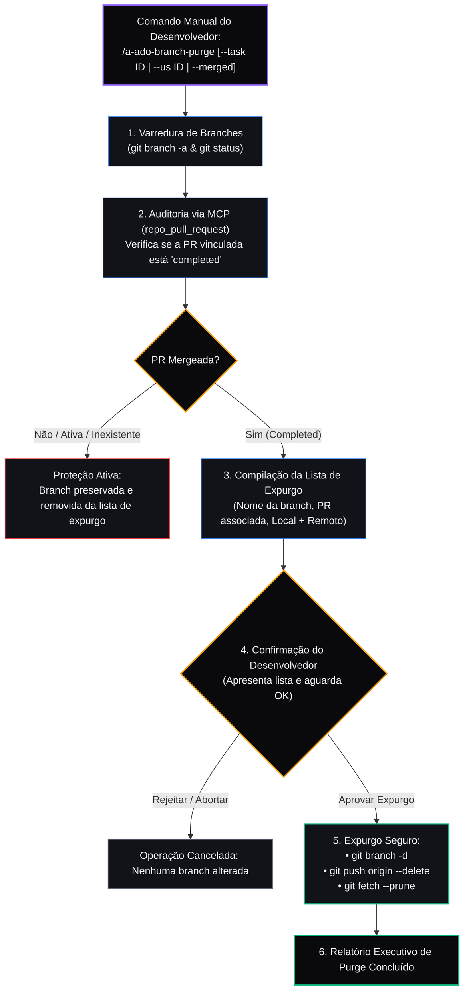

# Atom: `a-ado-branch-purge` (Manual Safe Branch Expurger & Purger)

Átomo cirúrgico de **governança e limpeza manual sob demanda** responsável por expurgar com total segurança branches locais e remotas associadas a Subtasks SMART (`feat/us-<US_ID>-task-<TASK_ID>`) ou User Stories INVEST (`feat/us-<US_ID>`) cujas Pull Requests já foram formalmente **concluídas e mergeadas** (`Completed`/`Merged`) no Azure DevOps.

> [!CAUTION]
> **Governança Estrita & Zero Deleção Automatizada:**  
> Este átomo é **exclusivamente acionado de forma manual pelo desenvolvedor**. Nenhum agente autônomo ou despachante de background executa a deleção de branches sem intervenção direta. Isso elimina completamente o risco de alucinações, exclusão precoce de código em revisão ou perda acidental de branches ativas.

---

## ⚡ Configuração & Resolução Agnóstica de Contexto (SSoT)

> **Resolução de Parâmetros do Workspace:** Este átomo é agnóstico de projeto. Obtenha o nome do projeto (`<PROJECT_NAME>`) e do repositório (`<REPO_NAME>`) a partir das instruções do workspace ativo (`AGENTS.md`, `CLAUDE.md` ou Wiki SSoT como `knowledge/wiki/engineering/arquitetura-skills-atomicas.md`).

* **MCP Server:** `azure-devops`
* **Tools Utilizadas:** `repo_pull_request` (`action: "list"` ou `"get"` com filtro de status `completed`)
* **Project Name:** `<PROJECT_NAME>` (obtido da SSoT / `AGENTS.md` do workspace)
* **Repository Name:** `<REPO_NAME>` (obtido da SSoT / `AGENTS.md` do workspace)
* **Branches Protegidas (Imutáveis):** `main`, `master` e branches ativas sem merge.

---

## 🎯 Contrato do Átomo (Single Responsibility)

* **Input Esperado:**
  * Modo de Operação:
    * Por Tarefa: `--task <TASK_ID>` (ex.: `feat/us-139-task-140`).
    * Por História INVEST: `--us <US_ID>` (todas as sub-branches da história cuja PR Nível 1 ou Nível 2 já foi mergeada).
    * Varredura Geral de Concluídas: `--merged` (identifica todas as branches locais/remotas com PR fechada).
* **Regras de Guarda de Segurança:**
  1. **Validação de Merge Obrigatória:**
     * Antes de qualquer ação, verifica no Azure DevOps se a Pull Request vinculada à branch possui status `completed` (mergeada).
     * Se a PR estiver `active`, `abandoned` ou inexistente, a branch é **imediatamente protegida** e o expurgo é recusado.
  2. **Bloqueio de Branches Canônicas:**
     * `main` e `master` nunca podem ser selecionadas ou deletadas sob nenhuma hipótese.
  3. **Confirmação Explícita Pré-Deleção:**
     * Apresenta um inventário detalhado contendo:
       - Nome da branch.
       - Status no Azure DevOps (PR ID e status `completed`).
       - Destino da exclusão (Local, Remoto ou Ambos).
     * Aguarda confirmação direta do usuário antes de rodar os comandos de exclusão.
* **Output Determinístico:**
  * Branches locais deletadas via `git branch -d` (ou `-D` com confirmação).
  * Branches remotas deletadas via `git push origin --delete <branch>`.
  * Metadados locais sincronizados via `git fetch --prune`.
  * Relatório de auditoria detalhando as branches purgadas.
* **Fronteira Estrita (O que NÃO faz):**
  * **NÃO** roda automaticamente em background nem é acionado sem comando explícito.
  * **NÃO** deleta branches cuja PR ainda esteja aberta em Code Review.
  * **NÃO** altera Work Items no Azure Boards.

---

## ⚙️ Protocolo de Execução Passo a Passo



### 1. Identificação e Varredura
* Obter lista de branches locais e remotas:
  ```bash
  git branch --list
  git branch -r --list "origin/feat/*"
  ```

### 2. Validação no Azure DevOps via MCP
* Para cada branch candidata (ex.: `feat/us-139-task-140`):
  * Invocar `repo_pull_request` no servidor `azure-devops`:
    ```json
    call_mcp_tool(
      ServerName="azure-devops",
      ToolName="repo_pull_request",
      Arguments={
        "action": "list",
        "project": "<PROJECT_NAME>",
        "repositoryId": "<REPO_NAME>",
        "sourceRefName": "refs/heads/feat/us-139-task-140",
        "status": "completed"
      }
    )
    ```
  * Se não houver PR com status `completed`, a branch é ignorada.

### 3. Confirmação do Desenvolvedor
* Exibir tabela consolidada:
  ```markdown
  | Branch | PR Vinculada | Status PR | Excluir Local? | Excluir Remoto? |
  | :--- | :--- | :--- | :--- | :--- |
  | feat/us-139-task-140 | PR #62 | Completed (Merged) | Sim | Sim |
  ```
* Solicitar: `"Confirma a exclusão segura das branches acima?"`.

### 4. Execução Cirúrgica
* Efetuar a remoção local:
  ```bash
  git branch -d feat/us-139-task-140
  ```
* Efetuar a remoção remota:
  ```bash
  git push origin --delete feat/us-139-task-140
  ```
* Atualizar referências locais:
  ```bash
  git fetch --prune
  ```
