# Molecule: `m-ado-autonomous-dev` (Autonomous Risk-Driven Inner Loop)

Molécula de orquestração agêntica responsável por conduzir o ciclo completo de **Inner Loop de Desenvolvimento Autônomo** para uma Subtask SMART (`#<TASK_ID>`) ou Card Standalone (`#<CARD_ID>`), operando estritamente em Git Worktree isolada dentro de `.worktrees/` na raiz do projeto (`.worktrees/task-<TASK_ID>` ou `.worktrees/card-<CARD_ID>`), governada pelo **Contrato SSOT da Living Wiki** ([`knowledge/wiki/engineering/matriz-risco-governanca.md`](../../../knowledge/wiki/engineering/matriz-risco-governanca.md)).

---

## ⚡ Configuração & Resolução Agnóstica de Contexto (SSoT)

> **Resolução de Parâmetros do Workspace:** Esta molécula delega as chamadas ao Azure DevOps, Git e Wiki aos seus 11 átomos compostos (`uses`), resolvendo `<PROJECT_NAME>`, `<REPOSITORY_NAME>` e a tabela de arquivos sensíveis a partir de `AGENTS.md`, `CLAUDE.md` e `knowledge/wiki/engineering/matriz-risco-governanca.md`.

---

## 🏛️ Fluxo de Orquestração do Inner Loop

```mermaid
flowchart TD
    START["Início: Task #<TASK_ID> (m-ado-autonomous-dev)"] --> WORKTREE["1. Ambiente Isolado em .worktrees/ na Raiz do Projeto\n(Subtask: .worktrees/task-<TASK_ID> ➔ feat/us-<US_ID>-task-<TASK_ID>\nStandalone: .worktrees/card-<ID> ➔ <type>/card-<ID>)"]
    WORKTREE --> DEV["2. Desenvolvimento Iterativo TDD / IA-DLC\n(Código React, Testes Unitários, Wiki, Biome)"]
    DEV --> LEARN["3. Auto-Learn & Síntese Contínua na Wiki (Pré-Commit)\n(Captura decisões, feedbacks e correções em knowledge/wiki/ + log.md)"]
    LEARN --> HIER{"Card Standalone sem Subtasks?\n(Target = main)"}
    HIER -- "Sim (Standalone ➔ main)" --> BUMP["3.B Release Bump (a-ado-release-bump)\n(Incrementa SemVer em package.json + CHANGELOG.md)"]
    HIER -- "Não (Subtask SMART ➔ feat/us-)" --> TESTS{"4. Validação dos Sensores Locais\n(pnpm run quality-gate:full)"}
    BUMP --> TESTS
    TESTS -- "Falha" --> DEV
    TESTS -- "100% Verde" --> PUSH["5. Commit Semântico & Push Único Final\n(1 único git push origin branch)"]
    PUSH --> CONTRACT["6. Consulta ao Contrato SSOT da Wiki\n(knowledge/wiki/engineering/matriz-risco-governanca.md)"]
    CONTRACT --> DIFF["7. Inspeção Nativa: git diff --name-only origin/<target>...HEAD\n(Verifica arquivos sensíveis e elevação de risco)"]
    
    DIFF -- "Tocou Arquivo Sensível OU Risco Inicial != low" --> ESCALATE["Severidade Média / Escalonamento Sem Parada:\n• Eleva para risk:medium\n• Abre PR com autoComplete: false\n• Atribui Revisor Humano Obrigatório\n• Move card para 'Pending' (Aguarda revisão e aprovação)"]
    DIFF -- "Risco Baixo & Nenhum Arquivo Sensível" --> LOW["Severidade Baixa (Simples e Isolada):\n• Mantém risk:low\n• Abre PR com Auto-Merge (autoComplete: true, deleteSourceBranch: false)\n• Fecha Thread Vercel (status: 4)\n• Subtask SMART: integra na branch da US (Done) | Standalone: avança para 'Ready to Production'"]

    ESCALATE --> BOARD["8. Sincronização Final no Azure Boards & Resumo Executivo"]
    LOW --> BOARD
    BOARD --> END["Conclusão & Standby da Worktree até Merge"]

    style START fill:#0A0A0C,stroke:#3B82F6,stroke-width:2px,color:#F8FAFC
    style WORKTREE fill:#121318,stroke:#3B82F6,color:#F8FAFC
    style DEV fill:#121318,stroke:#3B82F6,color:#F8FAFC
    style LEARN fill:#121318,stroke:#10B981,stroke-width:2px,color:#F8FAFC
    style HIER fill:#0A0A0C,stroke:#3B82F6,color:#F8FAFC
    style BUMP fill:#121318,stroke:#3B82F6,stroke-width:2px,color:#F8FAFC
    style TESTS fill:#0A0A0C,stroke:#10B981,color:#F8FAFC
    style PUSH fill:#121318,stroke:#F59E0B,stroke-width:2px,color:#F8FAFC
    style CONTRACT fill:#121318,stroke:#F59E0B,stroke-width:2px,color:#F8FAFC
    style DIFF fill:#0A0A0C,stroke:#F59E0B,stroke-width:2px,color:#F8FAFC
    style ESCALATE fill:#121318,stroke:#EF4444,stroke-width:2px,color:#F8FAFC
    style LOW fill:#121318,stroke:#10B981,stroke-width:2px,color:#F8FAFC
    style BOARD fill:#121318,stroke:#10B981,color:#F8FAFC
    style END fill:#0A0A0C,stroke:#10B981,stroke-width:2px,color:#F8FAFC
```



---

## 🧩 Átomos Compostos

Esta molécula encadeia de forma determinística os seguintes átomos especializados:
1. **[`a-ado-board-gate`](../a-ado-board-gate/SKILL.md):** Trava de pré-voo que audita a planning do card pai e garante coluna `Developing`.
2. **[`a-ado-branch-setup`](../a-ado-branch-setup/SKILL.md):** Cria a branch remota, vincula o ArtifactLink no Azure Boards e posiciona o workspace.
3. **[`a-wiki-auditor`](../a-wiki-auditor/SKILL.md):** Auto-Learn, síntese de aprendizados/correções em `knowledge/wiki/`, atualização de `knowledge/log.md` e lint estrutural da Wiki.
4. **[`a-ado-release-bump`](../a-ado-release-bump/SKILL.md):** Cálculo de SemVer (`package.json`) e geração automatizada de `CHANGELOG.md` quando o card for **Standalone** (sem subtasks filhas, apontando direto para a `main`).
5. **[`a-ado-git-commit`](../a-ado-git-commit/SKILL.md):** Stage cirúrgico e commit semântico local no padrão Conventional Commits.
6. **[`a-ado-git-push`](../a-ado-git-push/SKILL.md):** Envio com upstream tracking para o repositório remoto.
7. **[`a-ado-pr-open`](../a-ado-pr-open/SKILL.md):** Abertura da Pull Request com template oficial (`feat.md` ou `main.md`).
8. **[`a-ado-pr-threads`](../a-ado-pr-threads/SKILL.md):** Triagem e resolução de comentários (auto-close da thread Vercel com status 4).
9. **[`a-ado-us-summary`](../a-ado-us-summary/SKILL.md):** Publicação do resumo executivo na discussão do card INVEST.
10. **[`a-ado-task-sync`](../a-ado-task-sync/SKILL.md):** Sincronização de descrição SMART e estado no Azure Boards.

---

## 🎯 Contrato da Molécula

* **Input Esperado:**
  * `taskId`: ID do Work Item a ser implementado (`<TASK_ID>`, ex.: `140`).
  * `initialRisk`: Classificação inicial de risco (`low` | `medium` | `high`, deduzida do card ou padrão `low`).
  * `port`: (Opcional) Porta dedicada atribuída pelo orquestrador (`PORT`, ex.: `3240`) para execução sem conflito local.
  * `playwrightBaseUrl`: (Opcional) URL base para validação E2E (`PLAYWRIGHT_TEST_BASE_URL`).
* **Regra Compulsória de Isolamento de Workspace (`.worktrees/` na Raiz do Projeto):**
  * O desenvolvimento **DEVE OBRIGATORIAMENTE OCORRER DENTRO DE `.worktrees/` NA RAIZ DO PROJETO** (`.worktrees/task-<TASK_ID>` ou `.worktrees/card-<TASK_ID>`), nunca fazendo `git checkout` diretamente na raiz do clone principal (`main`) e nunca utilizando `Workspace: "share"` (que cria pastas externas em `~/.gemini/antigravity/worktrees/`).
  * Tanto no agente principal quanto em subagentes (`Workspace: "inherit"`), a worktree DEVE ser criada e operada em `<repo_root>/.worktrees/task-<TASK_ID>` (ou `<repo_root>/.worktrees/card-<TASK_ID>`), garantindo que o clone raiz permaneça limpo e na branch `main`.
* **Output Determinístico:**
  * Código implementado, aprendizados sintetizados na Living Wiki (`Auto-Learn`) e 100% validado pelos sensores (`pnpm run quality-gate:full`) dentro da respectiva worktree.
  * Exatamente **1 push único** enviado para a branch remota.
  * Pull Request criada no Azure DevOps com destino hierárquico canônico.
  * Card atualizado no Azure Boards:
    - **Se `risk:low` (sem arquivos sensíveis):** PR com merge automático (`autoComplete: true`, `deleteSourceBranch: false`), thread da Vercel resolvida (`status: 4`); Subtask SMART integra automaticamente na branch da história INVEST (`Done`, mantendo a US pai em `Developing`) e Card Standalone avança para **`Ready to Production`**.
    - **Se `risk:medium` (ou Escalonamento Sem Parada por arquivo sensível):** PR com `autoComplete: false`, revisor humano obrigatório atribuído e card movido para **`Pending`** (`State: Pending`) para revisão e aprovação manual.
    - **Se `risk:high` (Alta Complexidade):** O próprio desenvolvedor humano pega para fazer do início ao fim, executando exatamente este mesmo processo padronizado em `.worktrees/`.
* **Fronteira Estrita (O que NÃO faz):**
  * **NÃO** faz rollback destrutivo na árvore do Git; segue a filosofia **Roll-Forward**.
  * **NÃO** faz pushes intermediários ou parciais para evitar desperdício de cotas de build da Vercel.
  * **NÃO** deleta branches locais nem remotas; toda exclusão é manual via `a-ado-branch-purge`.
  * **NÃO** descarta ou remove a worktree local enquanto a PR estiver aberta, mantendo-se em standby para eventuais ajustes de Code Review.

---

## ⚙️ Protocolo de Execução Passo a Passo

### 1. Inicialização, Validação de Dependências e Isolamento do Workspace (`.worktrees/` na Raiz do Projeto)
* Inspecionar o card no Azure DevOps via `wit_work_item`.
* **Identificação de Hierarquia:**
  - Se possuir pai (`System.Parent` / `Hierarchy-Reverse`): Trata-se de **Subtask SMART**. A branch base é `feat/us-<US_ID>` e a sub-branch de trabalho é `feat/us-<US_ID>-task-<TASK_ID>`. A PR apontará para `feat/us-<US_ID>` (Nível 1).
  - Se NÃO possuir pai: Trata-se de **Card Standalone INVEST** (`refactor`, `fix`, `chore`, `docs`, `perf`, `style`, `test`). A branch nasce direto da `main` (`<type>/card-<TASK_ID>`). A PR apontará diretamente para a `main`.
* **Trava de Pré-Voo e Dependências entre Tasks (`a-ado-board-gate`):**
  - Antes de criar ou entrar na worktree, executar obrigatoriamente o `a-ado-board-gate` para validar:
    1. **Planning Concluída** no card pai `#<US_ID>`.
    2. **Ausência de Dependências Pendentes / Colisão de Arquivos (Dependency & Wave Gate):** Verificar nas relações (`System.LinkTypes.Dependency-Reverse` / `Predecessor`) e nas demais subtasks irmãs da US `#<US_ID>` se a Task `#<TASK_ID>` depende de outra tarefa irmã (`#<PREDECESSOR_ID>`) ou compartilha os mesmos arquivos-alvo com uma tarefa anterior/em andamento.
       - Se existir uma task predecessora ou colidente que ainda **não** esteja com `System.State == "Done"` **e** com sua PR Nível 1 formalmente **mergeada (`completed`)** na branch `origin/feat/us-<US_ID>`, **ABORTAR IMEDIATAMENTE** o provisionamento da worktree (`🛑 GATE BLOCKED: Unmet Dependency on Task #<PREDECESSOR_ID>`), prevenindo conflitos de merge e retrabalho redundante.
* **Garantia de Worktree em `.worktrees/` na Raiz do Projeto (`a-ado-branch-setup`):**
  - Somente após o gate aprovar (`PASSED`), posicionar o workspace com `a-ado-branch-setup`.
  - Nunca utilize `Workspace: "share"` (que cria pastas em `~/.gemini/antigravity/worktrees/`) e nunca execute `git checkout` na raiz do repositório (`main`).
  - Provisionar obrigatoriamente a Git Worktree isolada dentro da pasta `.worktrees/` na raiz do projeto (`.worktrees/task-<TASK_ID>` ou `.worktrees/card-<TASK_ID>`), sempre a partir de `origin/feat/us-<US_ID>` recém-sincronizada via `git fetch origin` (garantindo que o código mergeado de tasks predecessoras esteja presente):
    ```bash
    git fetch origin
    mkdir -p .worktrees
    git worktree add -B <branch_name> .worktrees/<dir_name> <base_branch>
    ```
  - Todas as operações de código, testes, build e commits subsequentes devem ocorrer estritamente dentro de `.worktrees/<dir_name>`.

### 2. Desenvolvimento Iterativo com TDD / IA-DLC
* Implementar a solução em conformidade com as diretrizes da Living Wiki (`knowledge/wiki/engineering/diretrizes-codigo-frontend.md`).
* Manter o ciclo puramente local: escrita de código, testes unitários co-localizados (`.test.tsx`), formatação com Biome (`pnpm run check:write`) e checagem de tipos (`pnpm run typecheck`).

### 3. Auto-Learn & Síntese Contínua na Living Wiki (Pré-Commit)
Para contornar a dependência de comandos manuais de interface (`/learn`) e assegurar que todo aprendizado, decisão arquitetural, correção de fluxo ou feedback do desenvolvedor seja persistido de forma 100% autônoma antes do push:
* **Detecção de Aprendizado / Correção:** Verificar se durante a sessão houve:
  1. Correção ou alinhamento explícito do desenvolvedor (ex.: ajuste de protocolo, governança, worktree, convenção de código ou ferramenta MCP);
  2. Descoberta técnica ou workaround estrutural de API/SDK (ex.: schemas exatos de ferramentas MCP, comportamentos do Next.js 16.4.2, etc.);
  3. Evolução de contratos de skills em `.agents/skills/`.
* **Síntese Direta na SSOT (`a-wiki-auditor`):**
  - **Nunca** criar arquivos soltos em `.agents/rules/`.
  - Sintetizar a regra ou decisão diretamente na página correspondente em `knowledge/wiki/` (e no contrato da skill em `.agents/skills/`, quando aplicável).
  - Se uma nova página for criada ou seu escopo mudar, atualizar `knowledge/index.md` ( e `pnpm run catalog:skills` caso envolva skills).
  - Prepender o registro cronológico em `knowledge/log.md` sob a tag `learn` (ou `docs`/`refactor`):
    ```markdown
    ## [YYYY-MM-DD] learn | <Título conciso do aprendizado ou diretriz consolidada>
    * **Operação:** Síntese autônoma de aprendizado (Auto-Learn pré-push) em `<arquivos_alvo>`.
    * **Contexto:** <Origem da correção ou decisão técnica tomada no Card #<TASK_ID>>.
    * **Ações Executadas:**
      - <Lista objetiva das regras ou contratos atualizados>.
    ```
* **Validação Determinística Unificada & Release Bump Condicional (Cards Standalone):**
  - **Se Card Standalone (sem subtasks filhas, PR direta ➔ `main`):**
    Executar obrigatoriamente o cálculo SemVer e a redação do `CHANGELOG.md` seguindo [`a-ado-release-bump`](../a-ado-release-bump/SKILL.md) (incrementando `"version"` em `package.json` — `minor` para `feat`, `patch` para `fix/refactor/perf/docs/chore/style/test` — e prependendo a seção da release no topo do `CHANGELOG.md`).
    > **Importante sobre Avaliação de Risco em Cards Standalone:** Quando `package.json` é alterado exclusivamente no campo `"version"` pelo `a-ado-release-bump`, essa modificação faz parte do rito canônico de release e **não** deve disparar escalonamento por sensibilidade de dependências (o escalonamento de `package.json` aplica-se apenas quando `dependencies`, `devDependencies` ou `scripts` forem alterados).
  - **Se Subtask SMART (possui card pai `feat/us-<US_ID>`):**
    **Não** executar bump SemVer individual na subtask (o bump consolidado será feito ao final da história via `m-ado-release`).
  - Executar a suíte completa de sensores determinísticos (que inclui `pnpm run lint:wiki`, testes, typecheck e Biome):
    ```bash
    pnpm run quality-gate:full
    ```
* Se houver falhas, iterar e corrigir localmente. **Nenhum `git push` é permitido antes que o código e a Wiki estejam 100% verdes**.

### 4. Commit Local Semântico & Push Único Final
* Se subagentes foram despachados na sessão ou se desejar vincular a sessão explicitamente ao card no AgentsView, rotular opcionalmente via `agentsview session label antigravity:<SESSION_ID> card=<TASK_ID>` (e `agentsview session parent antigravity:<SUBAGENT_ID> antigravity:<SESSION_ID>`).
* Executar `a-ado-git-commit` para realizar o stage cirúrgico (incluindo código, testes e aprendizados da Wiki/skills) e criar o commit no padrão Conventional Commits com rastreabilidade ao card e trailer `Agent-Session: antigravity:<SESSION_ID>`:
  - Subtask SMART: `<type>(<scope>): <descrição> (#<TASK_ID>)`
  - Card Standalone: `<type>(<scope>): <descrição> (#<CARD_ID>)`
* Executar **exatamente um único push** via `a-ado-git-push`:
  ```bash
  git push -u origin <branch_name>
  ```

### 5. Avaliação de Risco via Contrato SSOT na Wiki
* Ler o contrato oficial em `knowledge/wiki/engineering/matriz-risco-governanca.md`.
* Obter a lista de arquivos modificados em relação à branch alvo:
  ```bash
  git diff --name-only origin/<targetBranch>...HEAD
  ```
* **Verificação de Sensibilidade:**
  - Confrontar a lista de arquivos alterados com a **Tabela Canônica de Arquivos Sensíveis** (§2 de `matriz-risco-governanca.md`).
  - Se tocar em `package.json` (exceto quando a alteração no `package.json` for estritamente o bump de `"version"` gerado pelo `a-ado-release-bump` em cards standalone), `pnpm-lock.yaml`, `next.config.ts`, `tsconfig.json`, `vitest.config.mts`, `playwright.config.ts`, `.azuredevops/**`, `.github/**`, `.env*`, `.mcp.json`, `src/app/layout.tsx`, `src/app/page.tsx`, `src/app/global-error.tsx`, `src/app/error.tsx`, `src/middleware.ts`, `src/lib/telemetry.ts` ou `src/instrumentation.ts`:
    - **Acionar Escalonamento Sem Parada:** Definir `effectiveRisk = "medium"` e `escalated = true`.
  - Caso contrário:
    - Manter `effectiveRisk = initialRisk`.

### 6. Abertura e Configuração da Pull Request (`a-ado-pr-open`)
* Abrir a PR no Azure DevOps via `repo_pull_request_write`:
  - **Se Subtask SMART:** `targetRefName: refs/heads/feat/us-<US_ID>`, template `feat.md`.
  - **Se Card Standalone:** `targetRefName: refs/heads/main`, template `main.md`.

* **Abertura da PR e Política de Merge por Severidade:**
  - **1. Severidade Baixa (`risk:low` sem arquivos sensíveis — Subtask SMART simples ou Card Standalone simples):**
    - Abre a PR (`task ➔ feat/us-<ID>` ou `card ➔ main`) com merge automático (`autoComplete: true`, `deleteSourceBranch: false`, `mergeStrategy: "squash"`) e voto de aprovação `10` por ser simples e isolada.
    - Fecha a thread do bot da Vercel (`status: 4`).
    - Se for Subtask SMART: integra automaticamente na branch da história INVEST (`System.State: "Done"` na task, mantendo a US pai em `Developing`).
    - Se for Card Standalone: move o card no Azure Boards para a coluna **`Ready to Production`** (`System.State: "Ready to Production"`).
  - **2. Severidade Média (`risk:medium` ou Escalonamento Sem Parada via `git diff`):**
    - O agente executa em worktree simultânea até abrir a PR (`autoComplete: false`), atribui o humano como revisor obrigatório (`vote: 0`), fecha a thread da Vercel (`status: 4`), move o card para **`Pending`** / `Code Review` (`System.State: "Pending"`) e mantém a worktree ativa em standby para ajustes rápidos apontados na revisão.
  - **3. Severidade Alta (`risk:high`):**
    - Executada pelo próprio desenvolvedor humano do início ao fim utilizando exatamente este mesmo processo padronizado.

### 7. Registro Executivo e Encerramento
* Invocar `a-ado-us-summary` para registrar na discussão do card INVEST o resumo conciso da entrega, a classificação de risco final e o link da PR.
* Confirmar no chat o painel de fechamento com: ID do Card, Risco Final, Status de Escalonamento, URL da PR e Coluna do Board.
