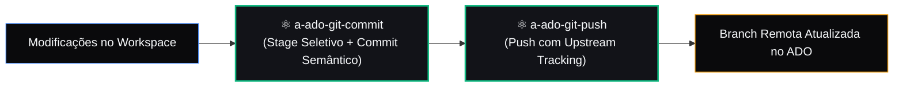

# Molecule: `m-ado-commit-push` (Semantic Commit & Remote Push Orchestrator)

Molécula de composição que orquestra dois átomos independentes de Git para executar o ciclo completo de versionamento e sincronização remota sem acoplamento de código:

---

## ⚡ Configuração & Resolução Agnóstica de Contexto (SSoT)

> **Resolução de Parâmetros do Workspace:** Esta molécula é agnóstica de projeto. Delega a extração de `<TASK_ID>` e `<US_ID>` (a partir do nome da branch ativa), o bloqueio das branches protegidas (`main` / `master`) e o envio ao `origin` para os átomos compostos `a-ado-git-commit` e `a-ado-git-push`.

---

## 🧩 Átomos Compostos

Esta molécula é formada exclusivamente pela orquestração de:
1. **[`a-ado-git-commit`](../a-ado-git-commit/SKILL.md):** Valida a branch de trabalho, adiciona arquivos pertinentes ao stage (`git add`) e gera o commit semântico com Conventional Commits e sufixo `#<TASK_ID>`.
2. **[`a-ado-git-push`](../a-ado-git-push/SKILL.md):** Executa o `git push -u origin <branch>` garantindo a proteção da `main` e o rastreamento do upstream remoto.

---

## 🎯 Contrato da Molécula

* **Input Esperado:**
  * Modificações no repositório local pertinentes à Task atual (`#<TASK_ID>`).
  * Branch de trabalho ativa (`feat/us-<US_ID>-task-<TASK_ID>` ou `feat/us-<US_ID>`).
* **Output Determinístico:**
  * Commit semântico criado e sub-branch sincronizada no repositório remoto `origin` do Azure DevOps.
  * Relatório de entrega contendo: hash do commit, mensagem semântica, arquivos enviados e confirmação de tracking.
* **Fronteira Estrita (O que NÃO faz):**
  * **NÃO** abre Pull Request (delegado ao átomo `a-ado-pr-open`).
  * **NÃO** altera o estado de Work Items no Azure Boards (delegado ao átomo `a-ado-task-sync`).

---

## ⚙️ Protocolo de Execução

1. **Etapa 1 — Commit Semântico:** Invocar o átomo [`a-ado-git-commit`](../a-ado-git-commit/SKILL.md) passando ou deduzindo a mensagem e arquivos da task ativa.
2. **Etapa 2 — Envio Remoto:** Caso o commit seja realizado com sucesso (ou já existam commits locais pendentes), invocar o átomo [`a-ado-git-push`](../a-ado-git-push/SKILL.md).
3. **Confirmação:** Retornar ao usuário o status consolidado de commit + push.
