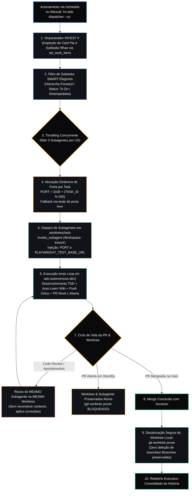

# Molecule: `m-ado-dispatcher` (INVEST Story Orchestrator & SMART Concurrent Worktree Dispatcher)

Molécula de orquestração de **segundo nível (Inner Loop Agêntico Concorrente)** responsável por gerenciar a execução autônoma de uma **User Story INVEST** (`#<US_ID>`) ou de múltiplas histórias INVEST em paralelo, despachando suas **Subtasks SMART** filhas para subagentes isolados em Git Worktrees dentro de `.worktrees/task-<TASK_ID>` na raiz do projeto, governada por alocação determinística de portas locais e preservação estrita de contexto até o merge formal na `main`.

---

## ⚡ Configuração & Resolução Agnóstica de Contexto (SSoT)

> **Resolução de Parâmetros do Workspace:** Esta molécula é agnóstica de projeto. Obtenha `<PROJECT_NAME>` e `<ASSIGNEE>` a partir das instruções do workspace ativo (`AGENTS.md`, `CLAUDE.md` ou Wiki SSoT como `knowledge/wiki/engineering/arquitetura-skills-atomicas.md`).

---

## 🏛️ Filosofia: Orquestração INVEST ➔ Subagentes SMART



---

## 🧩 Pilares de Arquitetura da Molécula

### 1. Orquestrador Especializado por História INVEST
* Cada instância do despachante assume a governança de uma **User Story INVEST** (`#<US_ID>`).
* Inspeciona via MCP `wit_work_item` as subtarefas SMART vinculadas (`Hierarchy-Forward` / `Child`).
* Múltiplas histórias INVEST podem ser orquestradas concorrentemente sem atrito, pois cada uma isola suas subtasks em sub-branches dedicadas (`feat/us-<US_ID>-task-<TASK_ID>`).

### 2. Gestão Determinística de Portas (Zero Colisões em Runtime)
Em ambientes de desenvolvimento com múltiplas worktrees executando tarefas em paralelo, a tentativa de subir servidores locais (`next dev`, `next start` ou servidores web do Playwright) na porta padrão `3000` gera falhas imediatas de `EADDRINUSE`.
* **Fórmula de Alocação:**
  $$\text{PORT} = 3100 + (\text{TASK\_ID} \pmod{500})$$
  *(Exemplos: Task 140 ➔ 3240; Task 141 ➔ 3241; Task 142 ➔ 3242; Task 146 ➔ 3246)*.
* **Teste Dinâmico de Disponibilidade (Fallback):**
  Antes de atribuir, o orquestrador verifica se a porta calculada já está escutando no host via shell (`lsof -i :<PORT>` ou `nc -z localhost <PORT>`). Se estiver ocupada, incrementa sequencialmente até encontrar uma porta livre.
* **Injeção de Ambiente no Subagente:**
  O subagente recebe as variáveis declaradas no seu prompt:
  ```bash
  export PORT=<allocated_port>
  export PLAYWRIGHT_TEST_BASE_URL="http://127.0.0.1:<allocated_port>"
  ```
  Isso garante que `pnpm dev -p $PORT` ou o `playwright.config.ts` operem com isolamento absoluto de rede local.

### 3. Throttling de Concorrência (Pool Máx 3 por US)
* Para preservar I/O, cota de CPU e consumo de memória local, o orquestrador limita a execução a **no máximo 3 subagentes ativos simultaneamente** por história INVEST.
* Subtasks excedentes aguardam em fila local até que um dos slots do pool seja liberado.

### 4. Ciclo de Vida da Worktree e Reuso de Subagente durante Review
* **Standby Ativo:** Quando o subagente conclui o desenvolvimento e abre a Pull Request (Nível 1), a Git Worktree local e o subagente associado **NÃO são destruídos**.
* **Reuso para Correções:** Se revisores humanos ou bots emitirem apontamentos na PR (`a-ado-pr-threads`), o **mesmo subagente existente é acionado na mesma worktree** para fazer os ajustes pontuais, sem perda de contexto ou recompilação desnecessária.
* **Prune Condicional Pós-Merge:** O comando de desalocação `git worktree prune` **SÓ PODE SER EXECUTADO** após confirmação via MCP de que a PR vinculada foi formalmente mergeada na `main` (ou na branch pai).

### 5. Governança Manual Estrita de Branches (Zero Auto-Purge)
* **Regra de Ouro:** O despachante e os subagentes **NUNCA DELETAM BRANCHES** (nem locais via `git branch -D`, nem remotas via `git push origin --delete`).
* Todo o histórico de branches permanece intacto após os merges.
* A purga de branches é delegada exclusivamente ao átomo de acionamento manual **[`a-ado-branch-purge`](../a-ado-branch-purge/SKILL.md)**.

---

## 🎯 Contrato da Molécula

* **Input Esperado:**
  * `usId`: ID da User Story INVEST pai (`<US_ID>`, ex.: `139`). Se omitido, inspeciona e lista histórias ativas em `Developing` no Azure Boards.
  * `maxConcurrent`: Limite máximo de subagentes simultâneos (default: `3`).
* **Output Determinístico:**
  * Subtasks SMART elegíveis despachadas e executadas em worktrees isoladas.
  * Pull Requests Nível 1 abertas vinculadas ao card pai no Azure Boards.
  * Worktrees mantidas em standby até merge formal.
  * Relatório executivo consolidado com estado de cada subtask, portas utilizadas e PRs abertas.
* **Fronteira Estrita (O que NÃO faz):**
  * **NÃO** deleta branches locais ou remotas (responsabilidade do átomo manual `a-ado-branch-purge`).
  * **NÃO** faz merge final da US para a `main` (responsabilidade da molécula `m-ado-release`).
  * **NÃO** executa `git worktree prune` enquanto a PR estiver aberta em revisão.

---

## ⚙️ Protocolo de Execução Passo a Passo

### 0. Bootstrap da Branch Pai & Migração de Protótipos `.stitch/`
* Verificar se `origin/feat/us-<US_ID>` existe (`git fetch origin && git branch -r | grep "feat/us-<US_ID>"`).
* Se não existir, criar remotamente a partir da `main` via MCP `repo_create_branch`.
* Verificar se há artefatos de prototipação da Fase 2A (`.stitch/designs/*.html`, `.stitch/metadata.json`) modificados ou untracked na raiz (`main`). Se houver:
  1. Criar uma worktree temporária `.worktrees/setup-<US_ID>` apontando para `origin/feat/us-<US_ID>`.
  2. Copiar os artefatos `.stitch/` modificados/novos para `.worktrees/setup-<US_ID>`, commitar (`chore(stitch): add approved prototypes (#<US_ID>)`) e dar push para `origin/feat/us-<US_ID>`.
  3. Remover `.worktrees/setup-<US_ID>` e restaurar a raiz `main` para estado 100% limpo (`git checkout -- .stitch/metadata.json` e remoção dos untracked já commitados na `feat/us-<US_ID>`), garantindo que todas as worktrees de subtasks herdem os protótipos aprovados sem sujar a `main`.

### 1. Inspecionar a User Story e Obter Subtasks SMART
* Consultar o card pai via `wit_work_item`:
  ```json
  call_mcp_tool(
    ServerName="azure-devops",
    ToolName="wit_work_item",
    Arguments={"action": "get", "project": "<PROJECT_NAME>", "id": <US_ID>, "expand": "All"}
  )
  ```
* Extrair todas as relações `System.LinkTypes.Hierarchy-Forward` (`Child`).
* Para cada child, verificar estado: selecionar as que estiverem em `System.State == "To Do"`.

### 2. Gerenciar Pool de Concorrência & Portas Dinâmicas
* Para cada subtask elegível:
  1. Verificar slot livre no pool (limite de 3 subagentes ativos).
  2. Calcular porta base: `PORT = 3100 + (TASK_ID % 500)`.
  3. Checar colisão de porta local via shell:
     ```bash
     lsof -i :$PORT >/dev/null 2>&1 && echo "in_use" || echo "free"
     ```
     Se `in_use`, incrementar `PORT = PORT + 1` até obter porta livre.

### 3. Disparo do Subagente em Worktree Isolada (`.worktrees/` na Raiz do Projeto)
* **Alocação Prévia Obrigatória no Azure Boards:** Antes de disparar o subagente de cada subtask, garantir via MCP `wit_work_item_write` que a Task `#<TASK_ID>` esteja alocada ao desenvolvedor padrão (`System.AssignedTo: "<ASSIGNEE>"`) e com `System.State: "Doing"`.
* **Proibição de Worktrees Fora do Projeto:** Nunca utilize `Workspace: "share"` ou `Workspace: "branch"` no `invoke_subagent` (pois eles alocam pastas fora do projeto em `~/.gemini/antigravity/worktrees/`). Utilize sempre `Workspace: "inherit"` e garanta que a worktree seja criada e operada estritamente em `<repo_root>/.worktrees/task-<TASK_ID>`.
* Disparar subagente usando `invoke_subagent`:
  - `TypeName`: `"self"`
  - `Workspace`: `"inherit"`
  - `Role`: `"Smart Task Developer #<TASK_ID>"`
  - `Prompt`:
    ```markdown
    Você é o subagente responsável por implementar a Subtask SMART #<TASK_ID> da US #<US_ID>.
    REGRA OBRIGATÓRIA DE DIRETÓRIO: Não execute git checkout na raiz do projeto (que deve permanecer na main). Crie e opere exclusivamente dentro da Git Worktree `.worktrees/task-<TASK_ID>` na raiz do projeto (`git worktree add -B feat/us-<US_ID>-task-<TASK_ID> .worktrees/task-<TASK_ID> origin/feat/us-<US_ID>`).
    Sua porta dedicada é: PORT=<PORT>.
    Configure PLAYWRIGHT_TEST_BASE_URL="http://127.0.0.1:<PORT>".
    Execute a molécula `m-ado-autonomous-dev` dentro de `.worktrees/task-<TASK_ID>`.
    Antes de fazer o commit e push único, execute obrigatoriamente a etapa de Auto-Learn / Síntese Contínua na Living Wiki (consolidando aprendizados, correções ou ajustes de protocolo em `knowledge/wiki/` e `knowledge/log.md`) e valide com:
    - Para ondas finais ou tarefas com E2E compatível: `PORT=<PORT> PLAYWRIGHT_TEST_BASE_URL="http://127.0.0.1:<PORT>" pnpm run quality-gate:full`.
    - Para ondas intermediárias de UI cujos testes E2E da rota alterada ainda pertencem a uma onda subsequente explicitamente planejada: `pnpm run quality-gate:fast` e `pnpm run build` (reservando `quality-gate:full` completo para a onda final de E2E/Visual).
    Ao concluir 100% dos testes locais aplicáveis, faça exatamente 1 push único e abra a PR Nível 1 para `feat/us-<US_ID>` já vinculando os Work Items (`workItems: "<TASK_ID> <US_ID>"`) com `autoComplete: false` (aguardando revisão humana).
    Mantenha este contexto ativo e não remova `.worktrees/task-<TASK_ID>`.
    ```

### 4. Monitoramento da PR, Dependências entre Ondas e Suporte a Correções
* Acompanhar notificações de mensagens dos subagentes.
* Se a PR exigir ajustes, enviar mensagem direcionada para o subagente responsável via `send_message(Recipient="<subagent_id>", Message="...")` para que a alteração seja feita na mesma worktree.
* **Isolamento de Porta com Preview Local:** Se o coordenador tiver iniciado um servidor `pnpm dev -p <PORT>` (`IsDaemon: true`) na worktree `.worktrees/task-<TASK_ID>` para visualização manual do usuário no browser e receber apontamentos de ajuste, deve **encerrar o daemon da porta `<PORT>` (`manage_task` com `Action: "kill"`) antes de enviar `send_message`** ao subagente (evitando conflito `EADDRINUSE` no Playwright durante `quality-gate:full`), reiniciando o preview em `<PORT>` após o push da correção.
* **Monitoramento Autônomo de Dependências entre Ondas (`schedule`):** Quando houver tasks de ondas subsequentes bloqueadas aguardando o merge de uma PR de dependência (ex.: Onda 1 ➔ Onda 2), o orquestrador cria um agendamento recorrente via `schedule` (`CronExpression: "* * * * *"`, `IsDaemon: false`) para consultar o status da PR bloqueante via MCP (`repo_pull_request`). Assim que a PR constar como `completed` (mergeada), o orquestrador cancela o agendamento (`manage_task` com `Action: "kill"`), executa `git worktree prune` da worktree concluída e despacha automaticamente as tasks da próxima onda sem aguardar comando manual.

### 5. Desalocação Pós-Merge Seguro
* Quando a PR for confirmada como `Completed`/`Merged` na branch pai:
  - Liberar o slot do pool.
  - Executar limpeza inofensiva de descritores de worktree locais desalocadas:
    ```bash
    git worktree prune
    ```
  - **Lembrar:** Nenhuma branch é deletada aqui.

### 6. Emissão do Relatório Silencioso & Executivo
Ao concluir a rodada, emitir tabela executiva com:
```markdown
### 📊 Relatório Executivo — Orquestração INVEST #<US_ID>

| Subtask SMART | Porta Dedicada | Worktree Branch | Status PR | Risco | Status Board |
| :--- | :--- | :--- | :--- | :--- | :--- |
| #140 | 3240 | feat/us-139-task-140 | PR #62 (Completed) | Low | Done |
| #141 | 3241 | feat/us-139-task-141 | PR #63 (Completed) | Low | Done |
| #142 | 3242 | feat/us-139-task-142 | Active (Em review) | Low | Doing |

> [!NOTE]
> Todas as branches locais e remotas permanecem íntegras no repositório. Para purga de branches já mergeadas, execute manualmente `/a-ado-branch-purge`.
```
