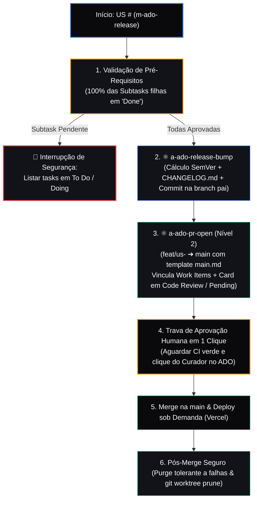

# Molecule: `m-ado-release` (INVEST & Standalone Release Consolidation & Main Publisher)

Molécula de orquestração de alto nível responsável pelo fechamento formal de uma **User Story INVEST** (`#<US_ID>`) ou **Card Standalone sem subtasks filhas** (`#<CARD_ID>`), integrando a branch de trabalho (`feat/us-<US_ID>` ou `<type>/card-<ID>`) à branch principal (`main`) com **Versionamento Semântico (SemVer)** automatizado, conformidade com os templates nativos do Azure DevOps e governança de **Aprovação Humana em 1 Clique**:

---

## ⚡ Configuração & Resolução Agnóstica de Contexto (SSoT)

> **Resolução de Parâmetros do Workspace:** Esta molécula é agnóstica de projeto. Obtenha `<PROJECT_NAME>` e `<REPOSITORY_NAME>` a partir das instruções do workspace ativo (`AGENTS.md`, `CLAUDE.md` ou Wiki SSoT como `knowledge/wiki/engineering/arquitetura-skills-atomicas.md`).



---

## 🧩 Átomos Compostos

Esta molécula compõe deterministicamente os seguintes átomos de automação:
1. **[`a-ado-release-bump`](../a-ado-release-bump/SKILL.md):** Inspeciona commits convencionais desde a última Git Tag estável, calcula o próximo incremento SemVer (minor, patch ou major), atualiza `package.json` e prepende o novo bloco no topo do `CHANGELOG.md`.
2. **[`a-ado-pr-open`](../a-ado-pr-open/SKILL.md):** Conduz a abertura da PR Nível 2 (`feat/us-<US_ID>` ➔ `main`) utilizando o template canônico `.azuredevops/pull_request_template/branches/main.md`, atribuindo o Curador como revisor e transicionando o card pai para `Code Review` / `Pending`.
3. **[`a-ado-task-sync`](../a-ado-task-sync/SKILL.md):** Garante a consistência dos metadados e estado dos cards no Azure Boards.

---

## 🎯 Contrato da Molécula

* **Input Esperado:**
  * `usId`: ID da User Story INVEST pai (`<US_ID>`, ex.: `139`).
* **Output Determinístico:**
  * Validação prévia de 100% das subtasks filhas SMART mergeadas e aprovadas na `feat/us-<US_ID>`.
  * `package.json` e `CHANGELOG.md` atualizados e commitados na `feat/us-<US_ID>`.
  * Pull Request Nível 2 aberta no Azure DevOps (`feat/us-<US_ID>` ➔ `main`) com Work Items vinculados.
  * Card pai movido para a coluna **`Code Review`** (`System.State = "Pending"`).
  * Painel de confirmação em 1 clique apresentado no chat com link da PR.
* **Fronteira Estrita (O que NÃO faz):**
  * **NÃO** faz merge automático descontrolado na `main`; exige aprovação humana e CI verde.
  * **NÃO** quebra o histórico via rollbacks destrutivos (rege-se pela filosofia **Roll-Forward**).

---

## ⚙️ Protocolo de Execução Passo a Passo

### 1. Inspeção de Pré-Requisitos no Azure Boards (`wit_work_item`)
* Consultar o card `<US_ID>` via ferramenta MCP `wit_work_item`:
  ```json
  call_mcp_tool(
    ServerName="azure-devops",
    ToolName="wit_work_item",
    Arguments={"action": "get", "project": "<PROJECT_NAME>", "id": <US_ID>, "expand": "All"}
  )
  ```
* Extrair todas as relações do tipo `System.LinkTypes.Hierarchy-Forward` (`Child`).
* **Cenário A — História com Subtasks SMART (`Child` > 0):**
  - Inspecionar cada subtarefa filha via `wit_work_item`: verificar se `fields["System.State"] == "Done"` ou se suas respectivas PRs Nível 1 foram concluídas e mergeadas na branch `feat/us-<US_ID>`.
  - **Trava de Pré-Requisito (Hard Stop):** Se houver alguma subtask filha com estado `To Do` ou `Doing`, **PARAR A EXECUÇÃO IMEDIATAMENTE** e reportar as tarefas pendentes ao operador.
* **Cenário B — Card Standalone sem Subtasks Filhas (`Child` == 0):**
  - Quando o card não possui subtasks filhas vinculadas, ele opera como **Card Standalone** (`<type>/card-<ID>` ➔ `main`) e **também deve passar obrigatoriamente pelo cálculo de SemVer e geração de `CHANGELOG.md` via `a-ado-release-bump`** antes da abertura ou merge da PR na `main`.

### 2. Sincronização Local da Branch Pai (`feat/us-<US_ID>`)
* Posicionar o repositório na feature branch pai:
  ```bash
  git fetch origin feat/us-<US_ID> main
  git checkout feat/us-<US_ID>
  git pull origin feat/us-<US_ID>
  ```

### 3. Invocação do Átomo `a-ado-release-bump`
* Executar o fluxo cirúrgico de [`.agents/skills/a-ado-release-bump/SKILL.md`](../a-ado-release-bump/SKILL.md):
  1. Identificar a última Git Tag (`git describe --tags --abbrev=0 2>/dev/null || echo "v0.0.0"`).
  2. Classificar os commits semânticos entre a tag e o `HEAD` da branch `feat/us-<US_ID>`.
  3. Incrementar o campo `version` em `package.json`.
  4. Preponder o bloco oficial de release no `CHANGELOG.md` com títulos dinâmicos derivados do problema resolvido e das entregas técnicas reais.
  5. Criar o commit semântico: `chore(release): bump v<NEXT_VERSION> e changelog (#<US_ID>)`.
  6. Enviar para o repositório remoto: `git push origin feat/us-<US_ID>`.

### 4. Telemetria Agêntica por SMART (`a-telemetry-agentsview`)
* Garantir que as tarifas locais e o índice do AgentsView estejam atualizados (`pnpm run usage:setup` e, se alguma sessão retornar `exit 2`, o `usage.mjs` executa `agentsview source sync` automaticamente). Caso novas tarifas sejam adicionadas ao `config.toml`, executar `agentsview daemon restart`.
* Executar `pnpm run usage:pr -- --session antigravity:<SESSION_ID>` individualmente para cada Subtask SMART (`#<TASK_ID>`) e para a sessão do Orquestrador (`#<US_ID>`), preenchendo obrigatoriamente a seção `## 💰 Telemetria Agêntica & Consumo de Tokens Consolidado (AgentsView)` na descrição da PR com tabela detalhada por Task/Sessão (`Steps`, `Input`, `Cache Read`, `Output`, `Peak Context` e `Custo USD`) e total consolidado, usando `n/a` apenas em caso de fallback não-bloqueante.

### 5. Abertura da Pull Request Nível 2 (`a-ado-pr-open`)
* Invocar o átomo [`.agents/skills/a-ado-pr-open/SKILL.md`](../a-ado-pr-open/SKILL.md) configurado para PR Nível 2:
  - `sourceRefName`: `refs/heads/feat/us-<US_ID>`
  - `targetRefName`: `refs/heads/main`
  - Template canônico: `.azuredevops/pull_request_template/branches/main.md`
  - Vincular todos os Work Items da US (ID pai `<US_ID>` e IDs de todas as subtasks filhas entregues).
  - Atualizar a coluna do Card Pai no Azure Boards para **`Code Review`** (`System.State = "Pending"` para tipos que suportam esse estado; para cards do tipo `chore`, que aceitam apenas `To Do | Doing | Done`, atualizar somente a coluna Kanban para `"Code Review"` mantendo `System.State = "Doing"`, evitando HTTP 400).
  - Atribuir o Curador como revisor padrão via MCP (`repo_pull_request_write` com `action: "update_reviewers"`).

### 5. Apresentação da Trava de Aprovação Humana em 1 Clique
* Reportar no chat executivo:
  - **ID da PR Nível 2** e link direto para o Azure Repos.
  - **Versão SemVer calculada:** `v<NEXT_VERSION>`.
  - **Resumo do Changelog** gerado.
  - **Instrução de 1 Clique:** "Aguarde a conclusão do QualityGate (CI) no Azure Pipelines e clique em **Approve & Complete Merge** na PR para publicar as alterações na branch `main`."

### 6. Pós-Merge Seguro (Housekeeping Tolerante a Falhas)
* Após a confirmação humana do merge na branch `main`:
  - Executar limpeza de worktrees locais:
    ```bash
    git worktree prune
    ```
  - Executar purge não-bloqueante (`try/catch`) da feature branch remota `feat/us-<US_ID>` via chamada MCP `repo_repository` ou comando Git:
    ```bash
    git push origin --delete feat/us-<US_ID> || true
    ```
  - Se houver falha na deleção da branch (ex.: permissão de branch lock), registrar aviso informativo sem travar o pipeline.
