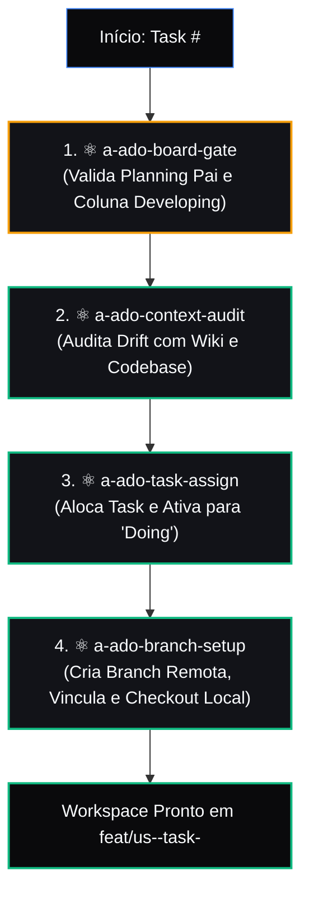

# Molecule: `m-ado-task-start` (Task Initialization & Branch Setup Orchestrator)

Molécula de orquestração que coordena quatro átomos especializados para preparar com segurança o workspace e o Azure Boards ao iniciar o desenvolvimento de uma nova Subtask SMART (`#<TASK_ID>`):

---

## ⚡ Configuração & Resolução Agnóstica de Contexto (SSoT)

> **Resolução de Parâmetros do Workspace:** Esta molécula é agnóstica de projeto. Delega a resolução de `<PROJECT_NAME>`, `<PROJECT_ID>`, `<REPOSITORY_NAME>`, `<REPOSITORY_ID>` e `<ASSIGNEE>` aos 4 átomos compostos (`a-ado-board-gate`, `a-ado-context-audit`, `a-ado-task-assign`, `a-ado-branch-setup`) a partir do `AGENTS.md` / SSoT do workspace.

---

## 🧩 Átomos Compostos

Esta molécula é formada exclusivamente pela orquestração de:
1. **[`a-ado-board-gate`](../a-ado-board-gate/SKILL.md):** Trava de pré-voo que audita a existência de subtarefas planejadas na User Story pai (`#<US_ID>`) e garante que ela esteja na coluna `Developing`.
2. **[`a-ado-context-audit`](../a-ado-context-audit/SKILL.md):** Inspeciona a descrição SMART e cruza com a Wiki e a árvore de arquivos para isolar itens obsoletos.
3. **[`a-ado-task-assign`](../a-ado-task-assign/SKILL.md):** Atribui a responsabilidade da task ao desenvolvedor no Azure Boards e ativa o estado para `Doing`.
4. **[`a-ado-branch-setup`](../a-ado-branch-setup/SKILL.md):** Cria a sub-branch remota oficial `feat/us-<US_ID>-task-<TASK_ID>` a partir de `feat/us-<US_ID>`, vincula o artefato ao card e faz `git fetch` + `git checkout` local.

---

## 🎯 Contrato da Molécula

* **Input Esperado:**
  * ID da Task (`<TASK_ID>`, ex.: `132`).
* **Output Determinístico:**
  * Card pai e task com status e colunas atualizados no Azure Boards.
  * Sub-branch criada, vinculada e ativa no terminal local.
  * Resumo executivo contendo o objetivo da tarefa e as referências canônicas.
* **Fronteira Estrita (O que NÃO faz):**
  * **NÃO** altera código da feature nem commita alterações.
  * **NÃO** abre Pull Request (delegado a `a-ado-pr-open`).

---

## ⚙️ Protocolo de Execução

1. **Gate do Board:** Invocar [`a-ado-board-gate`](../a-ado-board-gate/SKILL.md). Se bloqueado, abortar o fluxo.
2. **Auditoria de Contexto:** Invocar [`a-ado-context-audit`](../a-ado-context-audit/SKILL.md) e relatar se houve itens desconsiderados por já existirem.
3. **Alocação no Board:** Invocar [`a-ado-task-assign`](../a-ado-task-assign/SKILL.md) para registrar o desenvolvedor e o estado `Doing`.
4. **Setup Git & Vínculo:** Invocar [`a-ado-branch-setup`](../a-ado-branch-setup/SKILL.md) para disponibilizar o branch de trabalho local.
5. **Confirmação:** Apresentar painel consolidado com Task, US Pai, Branch e Escopo a implementar.
