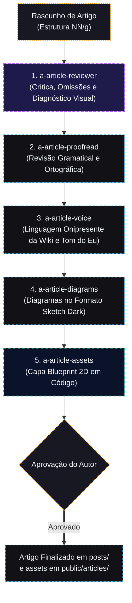

# Agentic Article Curator (Orquestrador Editorial)

Macro-skill e esteira orquestradora que estrutura e valida artigos técnicos de alta autoridade para o blog e LinkedIn, coordenando **átomos especializados** alinhados à Fonte Única da Verdade na LLM Wiki ([`knowledge/wiki/concepts/diretrizes-editoriais-tom-de-voz.md`](../../../knowledge/wiki/concepts/diretrizes-editoriais-tom-de-voz.md)).

---

## ⚡ Configuração & Resolução Agnóstica de Contexto (SSoT)

> **Resolução de Parâmetros do Workspace:** Esta molécula orquestra os 5 átomos editoriais consumindo as diretrizes de tom de voz ([`diretrizes-editoriais-tom-de-voz.md`](../../../knowledge/wiki/concepts/diretrizes-editoriais-tom-de-voz.md)), identidade visual ([`identidade-visual-agentic-curator.md`](../../../knowledge/wiki/concepts/identidade-visual-agentic-curator.md)) e o template canônico [`references/article-template.md`](./references/article-template.md).

---

## 🏗️ Arquitetura Atômica da Esteira

Em vez de executar tudo em um bloco monolítico, esta skill orquestra os 6 átomos independentes:

---

## 🧱 Átomos Especializados

Cada átomo pode ser acionado de forma isolada e sob demanda pelo autor:

1. **`a-article-reviewer`**: Realiza a análise crítica e o diagnóstico visual do artigo: identifica decisões de engenharia que passaram batidas, avalia poluição visual, sugere imagens autênticas do repositório (`brand/`, componentes) e aponta incoerências entre texto e diagramas.
2. **`a-article-proofread`**: Executa unicamente a correção de português, concordância, pontuação e sintaxe Markdown, sem reescrever ou alterar a essência do texto.
3. **`a-article-voice`**: Consome [`knowledge/wiki/concepts/diretrizes-editoriais-tom-de-voz.md`](../../../knowledge/wiki/concepts/diretrizes-editoriais-tom-de-voz.md) para aplicar a 1ª pessoa (*"Eu"*), a Linguagem Onipresente Compartilhada (Seções 3.1 e 3.2 da Wiki), a Regra do Efeito Prático e a estrutura editorial NN/g.
4. **`a-article-diagrams`**: Consome [`knowledge/wiki/concepts/identidade-visual-agentic-curator.md`](../../../knowledge/wiki/concepts/identidade-visual-agentic-curator.md) para construir ou converter diagramas Mermaid no formato artesanal **Sketch / Blueprint Dark**.
5. **`a-article-assets`**: Gera capas `1200x630` em código (HTML/CSS + Playwright) com estética **Dark Editorial + Blueprint Arquitetural 2D** para os cards da Home e Open Graph (sem imagens 3D sintéticas de IA e sem repetir o banner dentro do Markdown).
6. **Finalização da Entrega**: Consolida o markdown em `posts/<slug>.md` e imagens em `public/articles/<slug>/`. Aprendizados gerados pela escrita são documentados na Wiki sob demanda via `a-wiki-auditor`.

---

## 📐 Template Canônico de Artigo (NN/g + Frontend Engineering)

Todo artigo parte de [`references/article-template.md`](./references/article-template.md) e segue a especificação completa na **Seção 5 de [`diretrizes-editoriais-tom-de-voz.md`](../../../knowledge/wiki/concepts/diretrizes-editoriais-tom-de-voz.md)**:
* **Regra de Títulos Dinâmicos Baseados no Contexto (Não Aleatórios):** Nunca use rótulos fixos (`"Contexto:"`, `"Análise:"`, `"Implementação:"`, `"Resultados..."`, `"Conclusão"`), nem crie títulos aleatórios. **Leia e compreenda o contexto técnico, a dor e o objetivo específico de cada bloco de texto** e gere um título `##` (seção principal) ou `###` (subseção) natural que sintetize exatamente o que aquele trecho resolve.

---

## 📋 Checklist de Entrega

- [ ] Estrutura de 9 etapas narrativas, Pirâmide Invertida e hierarquia `##`/`###` com títulos derivados da compreensão do contexto ([`references/article-template.md`](./references/article-template.md)).
- [ ] Revisão linguística executada (`a-article-proofread`).
- [ ] Linguagem Onipresente da Wiki (Seções 3.1 e 3.2) e resumo para feed validados (`a-article-voice`).
- [ ] Diagramas Mermaid verticais modulares na paleta oficial aplicados (`a-article-diagrams`).
- [ ] Capa `1200x630` Blueprint 2D gerada em `public/articles/<slug>/` e sem banner repetido no corpo do Markdown (`a-article-assets`).
- [ ] Autor revisou o resultado e autorizou explicitamente o fechamento.
- [ ] Artigo publicado em `posts/` com assets vinculados em `public/articles/<slug>/` e aprovado pelo autor.
