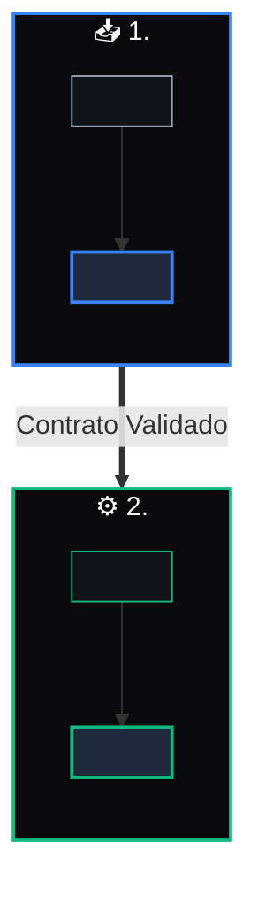
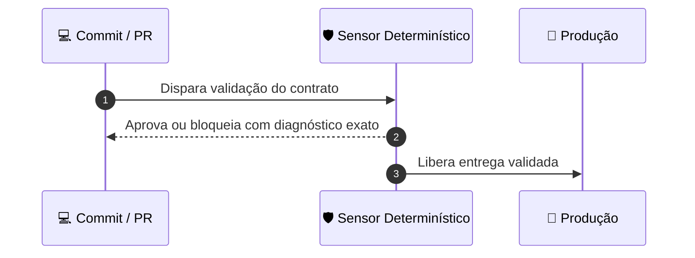

<!-- 
  ETAPA 2: INTRODUÇÃO EM PIRÂMIDE INVERTIDA (Sem Banner Repetido e Sem H2 inicial)
  Regras (conforme knowledge/wiki/concepts/diretrizes-editoriais-tom-de-voz.md):
  1. SEM BANNER REPETIDO NO CORPO: O campo `cover` no frontmatter é usado apenas nos cards da Home e no Open Graph (LinkedIn). Nunca insira `` nem `## H2` repetindo o título no início do Markdown.
  2. Pirâmide Invertida (NN/g): Comece pelo resultado principal, números e conclusão logo no primeiro parágrafo antes de detalhar a jornada.
  3. Tom de voz e Linguagem Onipresente: 1ª pessoa do singular ("Eu"), vivencial, direto, sem travessão longo (em-dash) e respeitando as tabelas 3.1 e 3.2 da Wiki.
-->
<Parágrafo 1 - Gancho e Conclusão Antecipada: Apresente o problema vivido na prática em primeira pessoa ("Eu") e declare imediatamente qual decisão arquitetural você tomou e o efeito prático alcançado.>

<Parágrafo 2 - Tensão Técnica: Explique rapidamente por que tutoriais comuns ou abordagens padrão falham nesse cenário e conecte com o artigo anterior da série, se aplicável.>

> *"<Frase curta e natural que sintetiza a tese prática ou aprendizado central do artigo, sem prefixos engessados como 'Princípio de Engenharia:'.>"*

<!-- 
  ETAPA 3: SUMÁRIO NAVEGÁVEL (Automático via ArticleToc)
  Regras Críticas de Títulos (## e ###):
  1. PROIBIDO USAR TÍTULOS DE RÓTULO FIXO: Nunca escreva literalmente "## Contexto: ...", "## Análise: ...", "## Implementação: ...", "## Resultados..." ou "## Conclusão".
  2. TÍTULOS BASEADOS NA COMPREENSÃO DO CONTEXTO (NÃO ALEATÓRIOS): As 9 etapas abaixo são a estrutura invisível da narrativa. Para criar cada título ## (H2) e ### (H3), leia e compreenda primeiro o contexto, o problema técnico e o objetivo real daquele bloco de texto e, com base nisso, formule um título natural e específico.
  3. HIERARQUIA DO TOC: Use sempre ## (H2) para seções principais e ### (H3) para subseções (extractHeadings ignora ####).
-->

---

## <Título H2 Natural de Contexto — Ex.: Por Que [Abordagem Comum] Quebra Quando [Cenário Real]>

<!-- 
  ETAPA 4 (Papel Narrativo: CONTEXTO E LIMITAÇÕES)
  Objetivo (NN/g - Avoid Commodity Status): Explicar o cenário real do sistema, as restrições arquiteturais e onde a abordagem tradicional quebra.
-->
<Contextualize o ambiente real da aplicação e liste as restrições objetivas que guiaram a tomada de decisão:>

1. **<Gargalo ou Restrição Específica 1>:** <O que quebrava na tela, no build ou na rotina manual.>
2. **<Gargalo ou Restrição Específica 2>:** <Qual limite de infraestrutura, tempo ou orçamento precisava ser respeitado.>
3. **<Gargalo ou Restrição Específica 3>:** <Qual garantia técnica faltava antes desta implementação.>

---

## <Título H2 Natural de Análise — Ex.: [Opção A], [Opção B] ou [Arquitetura Escolhida]?>

<!-- 
  ETAPA 5 (Papel Narrativo: ANÁLISE E DECISÕES ARQUITETURAIS)
  Objetivo (NN/g - Demonstrate Leadership & 5 Formatting Techniques): Demonstrar como você analisa problemas, compara alternativas e escolhe um caminho fundamentado.
-->
<Apresente de forma direta as opções comparadas antes de codificar:>

| Critério de Decisão | <Nome Real da Opção A> | <Nome Real da Opção B> | <Nome Real da Solução Escolhida> |
| :--- | :--- | :--- | :--- |
| **Custo e Infraestrutura** | <Detalhe concreto> | <Detalhe concreto> | **<Detalhe concreto>** |
| **Manutenção no Longo Prazo** | <Detalhe concreto> | <Detalhe concreto> | **<Detalhe concreto>** |
| **Risco de Regressão** | <Detalhe concreto> | <Detalhe concreto> | **<Detalhe concreto>** |

### <Subtítulo H3 Natural da Arquitetura — Ex.: Separando [Componente X] em [N] Etapas>

<Explique o racional técnico por trás da decisão vencedora e apresente o diagrama de arquitetura em orientação vertical (flowchart TB/TD) usando a paleta oficial Dark Mode (.stitch/DESIGN.md):>



---

## <Título H2 Natural de Implementação — Ex.: Como Construí [Mecanismo Principal] na Prática>

<!-- 
  ETAPA 6 (Papel Narrativo: IMPLEMENTAÇÃO)
  Objetivo (NN/g - In-Depth Content & Chunking): Demonstrar a construção real dividida em subseções H3 (###) com nomes específicos de cada mecanismo, código real e diagramas focados.
-->

### 1. <Subtítulo H3 Específico do 1º Mecanismo Técnico>

<Explicação direta do que foi implementado, qual problema específico resolve e qual o efeito prático no código:>

```typescript
// <caminho/real/do/arquivo.ts>
// Trecho real e focado na decisão técnica
```

### 2. <Subtítulo H3 Específico do 2º Mecanismo ou Sensor>

<Explicação da segunda etapa técnica, acompanhada de código ou diagrama de sequência/fluxo vertical:>



---

## <Título H2 Natural de Resultados e Trade-offs — Ex.: O Que Mudou na Rotina e o Preço Dessa Escolha>

<!-- 
  ETAPA 7 (Papel Narrativo: RESULTADOS, EVIDÊNCIAS E TRADE-OFFS)
  Objetivo (NN/g - Evidence & Expertise): Comprovar o impacto com métricas reais e demonstrar maturidade sênior expondo o que você ganhou vs. o que abriu mão.
-->

### <Subtítulo H3 com o Efeito Prático Principal — Ex.: [X] Minutos Poupados e Zero Falsos Positivos>

<Apresente os fatos e medições concretas no projeto:>

- **<Métrica ou Ganho Prático 1>:** <Quantos minutos de trabalho manual foram eliminados ou qual ganho de execução foi medido.>
- **<Métrica ou Ganho Prático 2>:** <O que parou de quebrar em compilação, testes ou produção.>
- **<Telemetria em Produção (HEART / DORA)>:** <Como esse comportamento continua sendo medido.>

### <Subtítulo H3 dos Trade-offs — Ex.: O Que Abri Mão: [Custo A] vs. [Benefício B]>

<Explicite os custos assumidos e os limites da decisão:>

- **<Trade-off 1 (ex.: Tempo extra de build vs. Repositório limpo)>:** <Explicar o custo aceito e por que ele se paga na rotina.>
- **<Quando NÃO usar esta abordagem>:** <Explicar em qual contexto ou escala esta solução não seria recomendada e qual alternativa faria mais sentido.>

---

## <Título H2 Natural de Fechamento — Ex.: [Síntese da Lição Principal do Artigo]>

<!-- 
  ETAPA 8 (Papel Narrativo: CONCLUSÃO)
  Objetivo: Consolidar os aprendizados práticos de engenharia com um título que sintetize a tese do artigo e abrir discussão qualificada.
-->
<Síntese direta conectando a dor inicial, a decisão arquitetural tomada e o aprendizado prático. Encerre com uma pergunta técnica aberta para os leitores.>

---

## <Título H2 Natural de Referências Derivado do Tema — Ex.: Leituras, Papers e Ferramentas Desta Arquitetura>

<!-- 
  ETAPA 9 (Papel Narrativo: REFERÊNCIAS E STACK)
  Objetivo: Dar crédito às fontes conceituais, documentações e listar as ferramentas aplicadas, com título H2 contextualizado ao tema do artigo (evitando rótulo fixo repetitivo em todos os posts).
-->
**Leituras e Documentações de Referência:**
* [<Título do Artigo ou Livro 1 - Autor / Fonte>](https://...) - <Conceito ou fundamento aplicado no artigo.>
* [<Título da Documentação ou Paper 2 - Fonte>](https://...) - <Referência técnica oficial utilizada.>

**Stack e Ferramentas Utilizadas:**
* **Frontend e Runtime:** <Next.js, React, TypeScript, Tailwind CSS...>
* **Sensores e Qualidade:** <Playwright, Vitest, Biome, Zod...>
* **CI/CD, Governança e IA:** <Azure DevOps, Vercel, MCP, LLM Wiki...>
