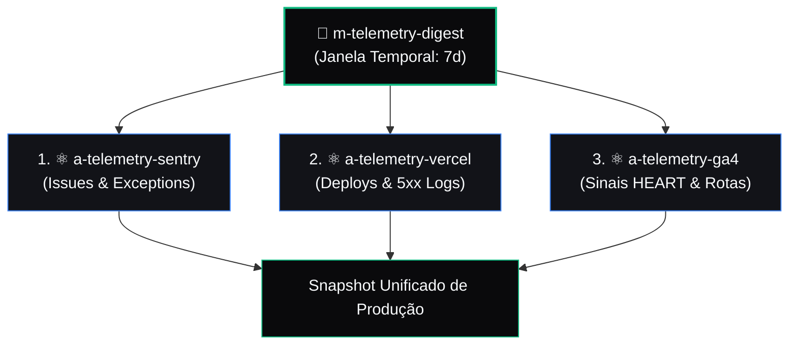

# Molecule: `m-telemetry-digest` (Production Telemetry Aggregator)

Molécula de composição que encadeia deterministicamente os três átomos especializados de telemetria de produção:
1. **[`a-telemetry-sentry`](../a-telemetry-sentry/SKILL.md):** Ingestão de issues, contagem de erros e stack traces.
2. **[`a-telemetry-vercel`](../a-telemetry-vercel/SKILL.md):** Ingestão de estado de deploys, builds e logs 5xx.
3. **[`a-telemetry-ga4`](../a-telemetry-ga4/SKILL.md):** Ingestão de métricas HEART (pageviews, CTAs, scroll depth, compartilhamentos).

---

## ⚡ Configuração & Resolução Agnóstica de Contexto (SSoT)

> **Resolução de Parâmetros do Workspace:** Esta molécula é agnóstica de projeto. Delega a resolução de `<PROJECT_NAME>`, `<SENTRY_ORG>`, `<VERCEL_PROJECT_ID>` e `GA4_PROPERTY_ID` aos seus 3 átomos compostos (`a-telemetry-sentry`, `a-telemetry-vercel`, `a-telemetry-ga4`) a partir do `AGENTS.md`, `.env` e `.vercel/project.json`.

---

## 🏛️ Fluxo de Composição



---

## 🎯 Contrato da Molécula (Deterministic Aggregation)

* **Input Esperado:**
  * `period`: Janela temporal (padrão: `7d` — últimos 7 dias).
* **Output Determinístico (Snapshot Unificado):**
  * Objeto consolidado ou bloco Markdown pronto contendo:
    * **Saúde Operacional (Sentry):** Volume de exceções não resolvidas e rotas afetadas.
    * **Saúde de Infraestrutura (Vercel):** Status do deploy ativo, integridade de build e contagem de erros 5xx.
    * **Engajamento & Produto (GA4):** Total de usuários ativos, top rotas, retenção (scroll depth) e conversão nos CTAs canônicos.
* **Fronteira Estrita (O que NÃO faz):**
  * **NÃO** calcula a classificação de risco (delegado a `a-telemetry-risk`).
  * **NÃO** cria cards no Azure Boards (delegado a `a-ado-item-create`).

---

## ⚙️ Protocolo de Execução

1. **Disparo Sequencial dos Átomos:**
   * Executar `a-telemetry-sentry` com `period: "7d"`.
   * Executar `a-telemetry-vercel` com `period: "7d"`.
   * Executar `a-telemetry-ga4` com `period: "7d"`.
2. **Consolidação em Estrutura Padronizada:**
   * Montar o documento de digest estruturado:
     ```markdown
     # Snapshot Unificado de Telemetria (Outer Loop)
     - Período: Últimos 7 dias
     - Saúde Técnica: [Sentry & Vercel status]
     - Comportamento de Uso: [GA4 HEART metrics]
     ```
3. **Entrega:** Retornar o snapshot para consumo pelo átomo de inteligência analítica `a-telemetry-risk`.
