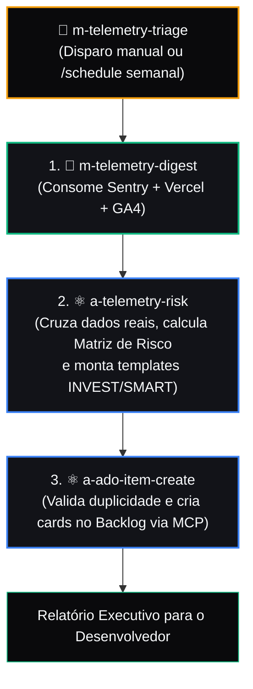

# Molecule: `m-telemetry-triage` (Outer Loop Telemetry-to-Backlog Orchestrator)

Molécula principal do ciclo de **Outer Loop** responsável por fechar o ciclo de vida do software (**Launch ➔ Measure ➔ Steer**). Coleta evidências empíricas reais de produção (erros, infraestrutura e sinais HEART de comportamento de uso), cruza com inteligência analítica para classificar riscos e popula autonomamente o Backlog do Azure Boards com cards INVEST e SMART preenchidos.

---

## ⚡ Configuração & Resolução Agnóstica de Contexto (SSoT)

> **Resolução de Parâmetros do Workspace:** Esta molécula é agnóstica de projeto. Delega a resolução de `<PROJECT_NAME>`, credenciais de telemetria e contrato de risco ([`matriz-risco-governanca.md`](../../../knowledge/wiki/engineering/matriz-risco-governanca.md)) à molécula `m-telemetry-digest` e aos átomos `a-telemetry-risk` e `a-ado-item-create`.

---

## 🏛️ Fluxo de Orquestração da Molécula



---

## ⏰ Configuração Recomendada de Automação (`/schedule`)

Para manter o backlog continuamente atualizado com base no uso real dos leitores sem sobrecarga operacional:

* **Cadência Oficial:** Semanal (toda segunda-feira às 08:00 BRT / `0 11 * * 1` UTC).
* **Comando do Antigravity:**
  ```text
  /schedule cron="0 11 * * 1" prompt="Execute a molécula m-telemetry-triage para auditar a telemetria dos últimos 7 dias e alimentar o Backlog com base em dados reais."
  ```
* **Regra de Ouro Antirruído:** A IA descarta flutuações pontuais de tráfego e só cria cards para:
  1. Exceções técnicas com $\ge 2$ ocorrências ou afetação de usuários reais.
  2. Quedas comprovadas em conversões HEART (ex.: rolagem alta sem clique em CTAs estratégicos).
  3. Falhas ou lentidão de deploys/runtime.

---

## 🎯 Contrato da Molécula

* **Input Esperado:**
  * `period`: Janela temporal (padrão: `7d`).
* **Output Determinístico:**
  * Diagnóstico analítico unificado apresentado ao desenvolvedor.
  * Novos cartões criados diretamente no **TOPO da coluna `Backlog`** do Azure Boards (via cálculo do menor `StackRank`), tipados estritamente na taxonomia herdada do Conventional Commits (`feat`, `refactor`, `perf`, `fix`, `chore`, etc.) com tags de risco (`risk:low`, `risk:medium`, `risk:high`).
* **Fronteira Estrita (O que NÃO faz):**
  * **NÃO** move cards para `Doing` ou `Developing` (itens nascem no `Backlog`).
  * **NÃO** executa código de implementação das features propostas.
